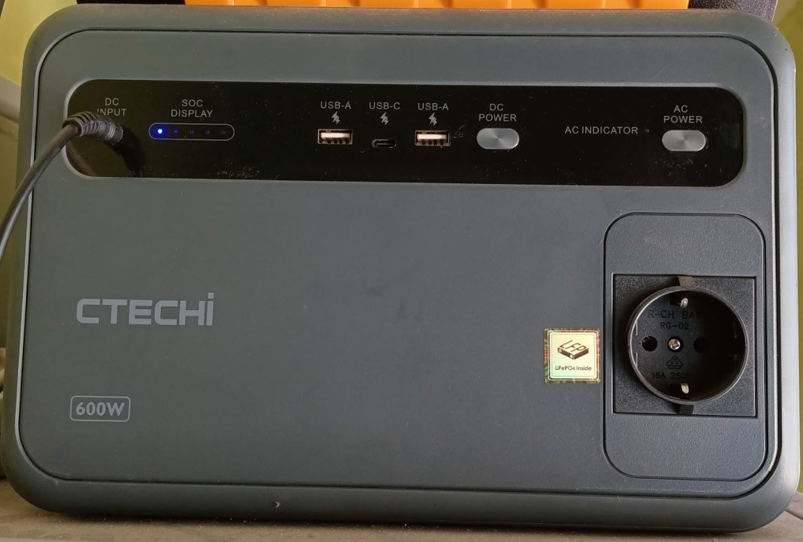
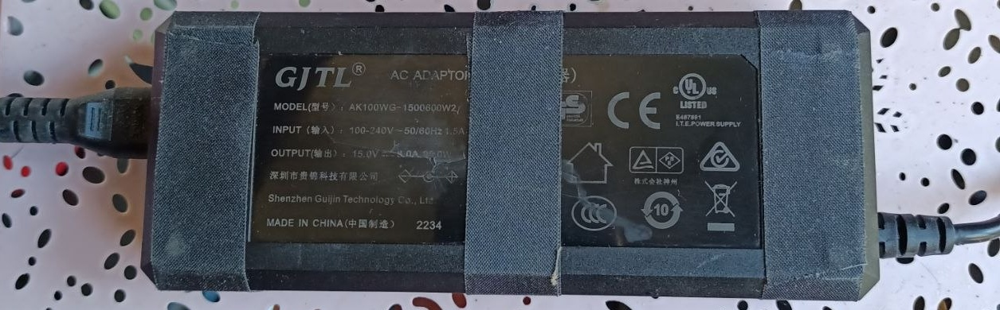
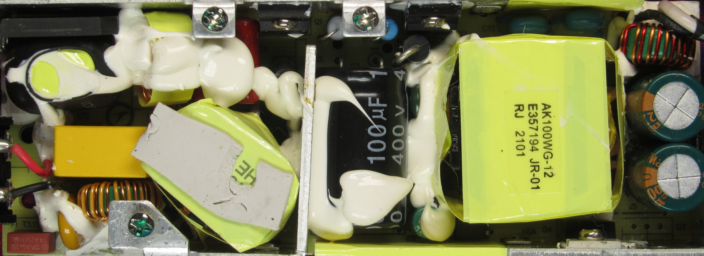
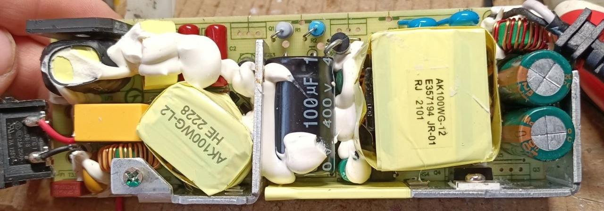
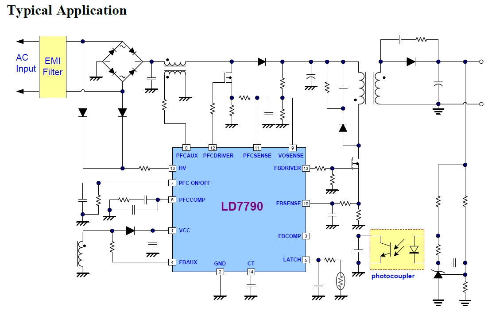
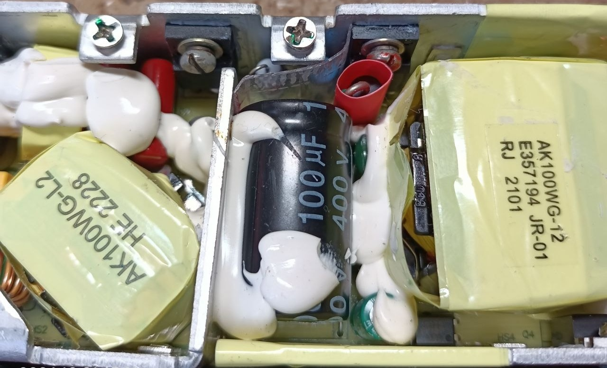
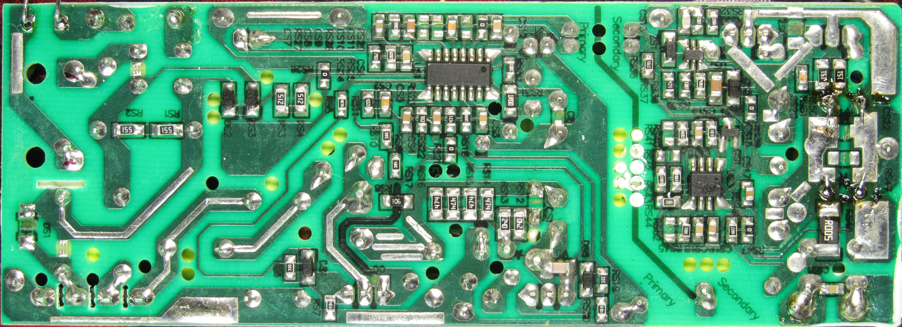
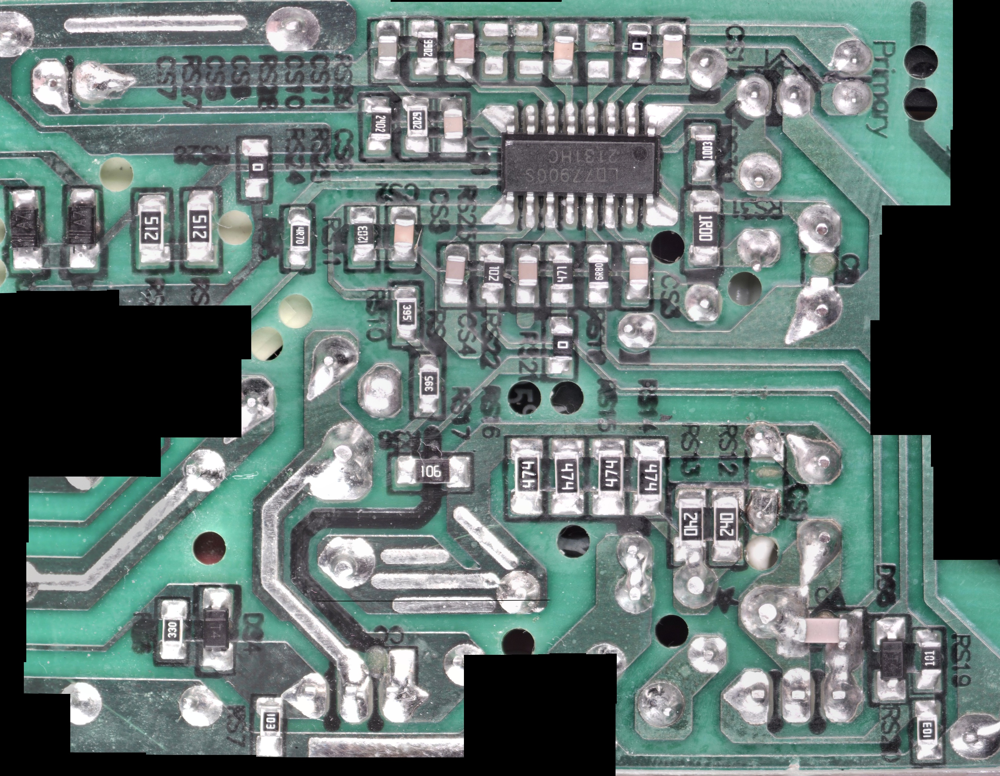
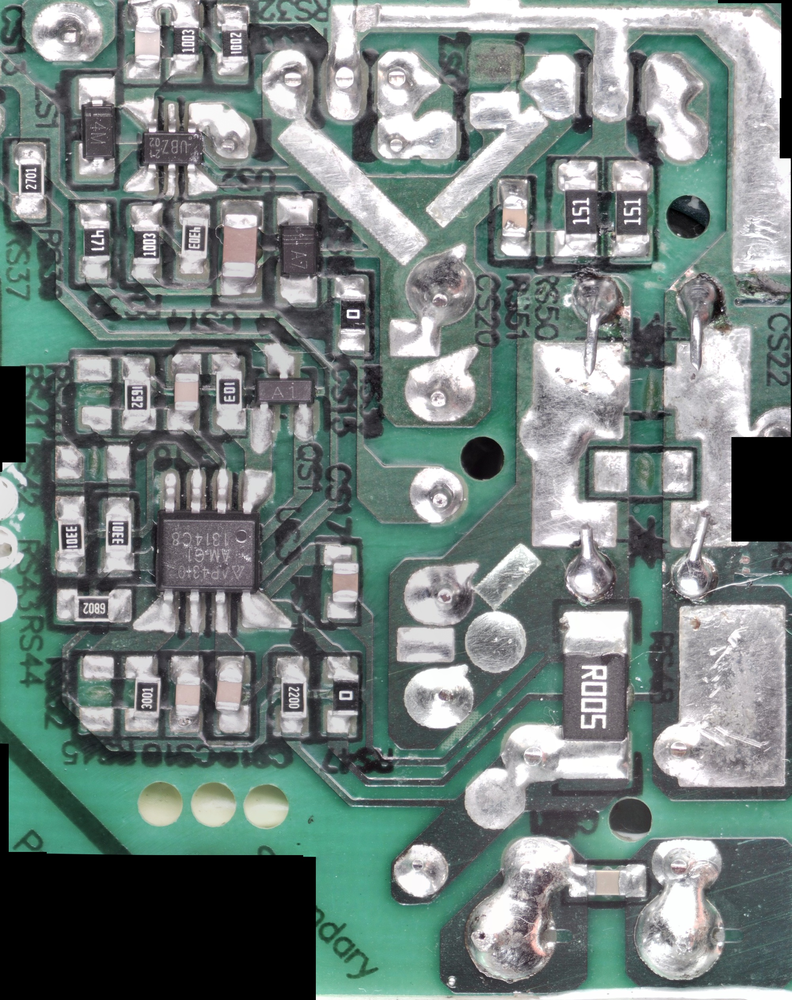
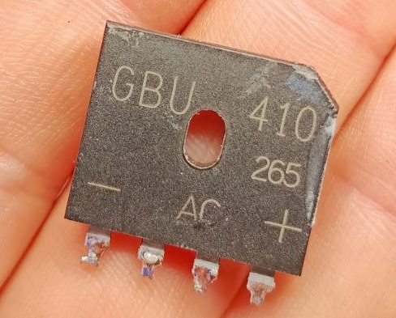

# Ремонт БП зарядной станции CTECHi 600W: GJTL 15 В / 6 А на LD7790 и AP4310

Есть у меня такая станция CTECHi 600W:

Работает в качестве бесперебойника для домашнего NAS. Не очень, конечно, хорошая роль для неё: сам NAS требует питания 12 В, и сюда бы подошёл специализированный низковольтный бесперебойник. Без лишнего преобразования из постоянки в 230 В и обратно. Но пока не было времени и сил этим заниматься... Впрочем, суть не в этом.

Поставляется станция с блоком питания **GJTL AK100WG-1500600W2**, производитель **Shenzhen Guijin Technology Co., Ltd.** И вот этот БП перестал подавать признаки жизни. Т.е. дорога ему на операционный стол.

Параметры блока такие:

| Параметр | Значение |
| --- | --- |
| Входное напряжение | 100–240 В AC |
| Частота сети | 50/60 Гц |
| Входной ток по маркировке | 1,5 А |
| Выходное напряжение | 15 В DC |
| Максимальный выходной ток | 6 А |
| Выходная мощность | 90 Вт |
| Полярность разъёма | Плюс в центре, минус снаружи |

600W в названии станции и 90 Вт у её БП тут не противоречат друг другу: первое относится к мощности выхода станции, второе к её сетевому адаптеру. Без него мой штатный способ зарядки от розетки, понятно, закончился.

Сразу оставлю даташиты, чтобы потом не искать:

- [LD7790: контроллер PFC и квазирезонансного flyback-преобразователя](ds/LD7790.pdf).
- [AP4310: два операционных усилителя и источник опорного напряжения для регулирования тока и напряжения](ds/AP4310.PDF).

## Вскрытие и классика жанра

Компоновка внутри такая:

Сверху всё это ещё закрыто алюминиевой пластиной, а-ля радиатор для магнитопроводов. Контакт с ними через термопрокладки. Вот ещё фото, здесь блок уже чуть подразобран:

Первое, что сразу обратило на себя внимание, это вздутые кондёры по выходу. Стояли два по **2200 мкФ / 25 В**. На фото они уже заменены на **Nichicon 2200 мкФ / 35 В**, такие были в наличии.

Новые буквально чуть выше оригинальных. Поэтому на внутренней стороне пластиковой крышки фрезой сделал углубление примерно на 1 мм, толщина пластика позволила.

Ладно, вздутые кондёры это, конечно, классика. Но уже на этом этапе показалось странным, что БП просто молчал. Часто при таком дефекте выход всё-таки есть, просто с пульсациями, просадками и прочими радостями, из-за которых подключённое устройство работает неправильно. Хотя совсем не запускаться из-за конденсаторов блок тоже может.

Подключаю на всякий случай через лампочку к сети, включаю... Тишина. На входе стоит предохранитель. Прозваниваю: обрыв.

Ладно, с предохранителем понятно. Но в голове крутится вопрос: «С хера ли он сгорел?»

## Проверяем силовую часть

Смотрю даташит на микруху в высоковольтной части. Это **LD7790**, два в одном: контроллер корректора коэффициента мощности, он же PFC, и контроллер основного квазирезонансного преобразователя.

Референсная схема включения такая. Это именно схема из даташита, не срисованная с этого БП:

Выпаял силовые MOSFET, проверил их, проверил входной диодный мост. Всё целое. Для проверки транзисторов пользуюсь вот таким приборчиком FNIRSI:

Понятно, такая проверка не гарантирует, что деталь не пробивается под рабочим напряжением, но явного коротыша нигде нет.

Раз всё целое, собираю обратно. Предохранитель поставил **4 А вместо штатного 3,15 А**, какой был под рукой. Для поиска неисправности, с лампочкой последовательно. Включаю. Лампочка начинает блимать, а в блоке что-то постреливает.

Блин... Сразу выключил, ...думаю.

И тут вспоминаю, что когда-то при ремонте UPS Powerware Prestige у меня уже было такое постреливание. Ничего нигде не задымилось, ток ограничен лампочкой. Начинаю подозревать, что где-то что-то пробивает.

Стреляло со стороны деталей, а плата при включении лежала дорожками вверх.

Ещё раз выпаиваю транзисторы. Снова проверяю. Целые.

Ок, раз такое дело, запаиваю обратно, кладу плату деталями вверх, выключаю настольную лампу. Будем смотреть, где стреляет... )

## Вот оно где шарахает

Ждать долго не пришлось. Вот в этой области:

Между выводами высоковольтного конденсатора и синим резистором шарахнула искра. С громким таким треском, как в БДСМ )

Блять, думаю...

Я ещё в таком районе живу, у нас влажность большая. Дома гигрометр показывает 60–70%. А там вроде нормальное расстояние, миллиметра 4–5. И простреливает, ппц. Исправный сухой воздушный зазор в 4–5 мм от обычных для такого БП нескольких сотен вольт пробивать не должен. Крч, решаю, что надо бы разделить эти детали изоляцией. Силикон лить не хочу, не люблю неразборные конструкции. Поэтому сделал так:

Между резисторами и кондёром вставил кусок прозрачного блистера, на силовой диод надел термоусадку. Резисторы здесь токовые шунты, подключённые к общему проводу первичной части. По соединениям в этом узле радиатор тоже на том же потенциале, поэтому между ними большого напряжения нет.

## Когда пригодился цапонлак

Собираю, включаю... С этой стороны теперь тихо. Но что-то пару раз треснуло с обратной стороны платы. БП как будто стартует, потом выключается, лампочка вспыхивает примерно раз в секунду.

Блин, думаю, ну с этим-то что делать? Само по себе мигание лампы ещё не доказывает срабатывание защиты: через последовательную лампу БП с PFC может недополучать питание и перезапускаться. Но треск с обратной стороны нормой всё равно не был.

Ладно, надо и там что-то сделать. А что?.. О, цапонлак.

Мою плату от флюса и покрываю высоковольтную часть цапонлаком. Саму микросхему и её пайку оставил непокрытыми. На будущее: вдруг всё-таки неисправна микра и придётся её выпаивать, не хочу потом ещё и лак отковыривать.

Кстати, вот плата с обратной стороны:

Включаю ещё раз и... Эврика! БП запустился, ничего не стреляет. И циклический перезапуск тоже «починился» сам по себе.
Судя по результату, очистка и покрытие помогли убрать поверхностную утечку или разряды.

Подключаю электронную нагрузку. Нагружаю на 100 мА, 200 мА, 400 мА. Полёт нормальный, едва слышно, как меняется тон работы преобразователя.

Сильно не нагружаю: мы же через лампочку 40 Вт включены. При 400 мА на выходе всего около 6 Вт, так что это проверка запуска и работы под небольшой нагрузкой, а не испытание на паспортные 90 Вт. Полный нагрузочный прогон здесь не проводился.

## Ещё немного механического мозгоёбства

Отдельного мозгоёбства добавила верхняя алюминиевая пластина. Конструкция вся эта малость кривая. А если уж делать так, чтобы пластина прилегала к магнитопроводам через термопрокладки, поверхности должны быть более-менее параллельны.

Пришлось и подогнуть, и шайбочки поставить. Фоток по этой части ремонта не делал.

## Фото для тех, кто тоже полезет внутрь

Может, кому-то понадобится узнать номиналы элементов или срисовать схему. Поэтому оставляю фото SMD-компонентов с микроскопа.

Высоковольтная часть, с LD7790:

Низковольтная часть, с AP4310:

Входной выпрямительный мост **GBU410**. Покажу, раз уж и его выпаивал:

Может, со временем нарисую полную схему этого БПшника. Пока есть проект платы в Sprint-Layout для реверса схемы. Фото со стороны дорожек можно использовать как шаблон:

В итоге поменяны два вздутых выходных конденсатора, заменён сгоревший предохранитель, очищена и изолирована область пробоев. Силовые MOSFET и диодный мост по результатам проверки остались родными. До замены LD7790 и AP4310 дело тоже не дошло.

Всё. БПшник отправился заряжать станцию CTECHi 600W.
