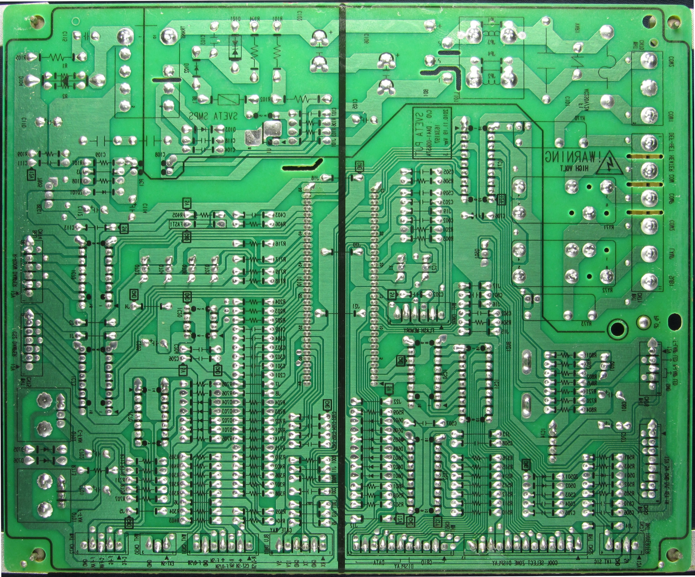
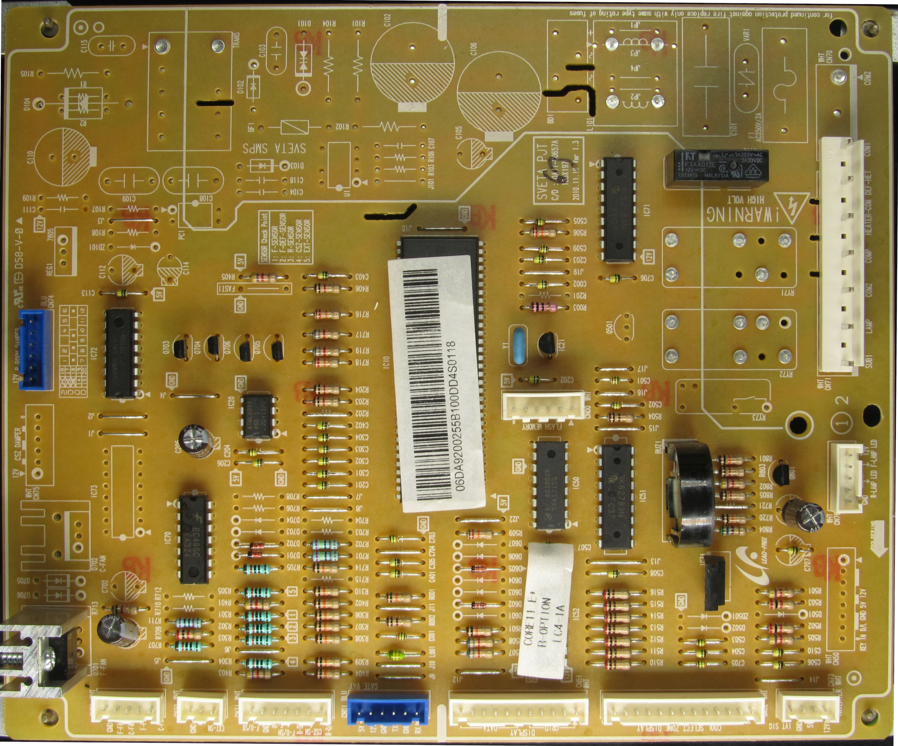

# Samsung RL50RQ — диагностика платы управления

Технические заметки по исследованию платы управления холодильника **Samsung RL50RQ**, проверке регулятора вентилятора и входной цепи температурного датчика.

В ходе диагностики были изучены цепи управления вентилятором, механизм контроля его вращения, схема подключения термодатчика и особенности отображения температуры.

**Итог:** неисправность контакта тахосигнала обнаружена непосредственно в вентиляторе. Необходимость ремонта платы управления не подтвердилась. Второе подозрение — некорректное отображение температуры холодильного отделения — вероятнее всего, объяснялось ограниченным диапазоном отображения.

## 1. Материалы

### Документация

- [Service Manual](manuals/CORE_11_RL50RQ-11.04.02.pdf) — сервисное руководство.
- [User Manual](manuals/DA99-03458B-21.pdf) — руководство пользователя.

### Фотографии платы

**Сторона пайки**



**Сторона компонентов**



### Восстановленные схемы

- [fan_fail.svg](fan_fail.svg) — регулятор напряжения питания вентилятора.
- [t-ctrl.svg](t-ctrl.svg) — входная измерительная цепь термодатчика.

---

## 2. Исходные жалобы

Плата поступила на диагностику с двумя жалобами:

1. Не работает вентилятор холодильника.
2. Дисплей холодильного отделения показывает `+9 °C` даже при первом включении холодильника, находившегося при комнатной температуре.

При этом морозильное отделение отображает фактическую температуру, в том числе положительные значения при первоначальном включении.

Изначально вентилятор для проверки предоставлен не был. Со слов владельца, он был полностью исправен.

Это обстоятельство существенно повлияло на последовательность диагностики.

---

## 3. Диагностика вентилятора

### 3.1. Первоначальная проверка

Поскольку сам вентилятор отсутствовал, сначала были исследованы цепи его управления на плате.

Была восстановлена схема линейного регулятора напряжения питания вентилятора, построенного на операционном усилителе **KA324** и PNP-транзисторе **TIP42C**.

Проверка не выявила неисправностей в исследованной цепи регулирования.

Однако исправность регулятора питания ещё не означает исправности всего узла вентилятора: контроллер также использует сигнал обратной связи о вращении.

### 3.2. Обнаруженная причина

После дополнительного запроса был предоставлен сам вентилятор.

При его проверке обнаружено отсутствие электрического контакта на выводе сигнала тахометра.

Таким образом:

- цепь питания и регулирования вентилятора была исправна;
- сигнал обратной связи о вращении не поступал корректно на контроллер;
- контроллер интерпретировал ситуацию как неисправность вентилятора и переходил в состояние ошибки.

Первоначальное утверждение об исправности вентилятора оказалось неверным.

**Важно:** неисправность находилась в цепи тахосигнала самого вентилятора. Её не следует путать с работой регулятора напряжения питания, рассматриваемого ниже.

---

## 4. Линейный регулятор скорости вентилятора


### 4.1. Назначение и состав

Схема представляет собой двухуровневый линейный регулятор скорости вентилятора с отрицательной обратной связью по выходному напряжению.

Основные элементы:

| Элемент | Назначение |
|---|---|
| KA324 | Операционный усилитель, управляющий регулирующим транзистором |
| TIP42C | PNP-транзистор верхнего плеча линейного регулятора |
| 2 × 2,4 кОм | Формирование управляющего напряжения от выходов MCU |
| 2 × диод | Развязка управляющих выходов |
| 10 кОм | Подтяжка управляющего узла к земле |
| 20 кОм + 10 кОм | Делитель обратной связи по выходному напряжению |
| 2 кОм | Резистор в цепи управления базой TIP42C |
| 1 кОм | Подтяжка базы TIP42C к +12 В |

Регулирование осуществляется изменением проводимости TIP42C. Операционный усилитель сравнивает заданное напряжение с сигналом обратной связи и управляет базой транзистора.

Входы управления связаны с двумя цифровыми выводами микроконтроллера S3F84NBXZZ-AT9B:

- `MCU_63`
- `MCU_64`

### 4.2. Обратная связь

Напряжение на неинвертирующем входе KA324 снимается с выходного делителя:

- верхний резистор — 20 кОм;
- нижний резистор — 10 кОм.

Поэтому:

$$
V_+ = V_{FAN}\frac{10}{20+10}
$$

Отсюда:

$$
V_+ = \frac{V_{FAN}}{3}
$$

При работе линейного регулятора в установившемся режиме:

$$
V_+ \approx V_-
$$

Следовательно:

$$
\boxed{V_{FAN} \approx 3V_{SET}}
$$

где \(V_{SET}\) — напряжение, формируемое цепью цифровых управляющих выходов.

Это соотношение справедливо, пока регулятор не достиг ограничения по выходному напряжению или управляющему диапазону.

### 4.3. Формирование управляющего напряжения

Каждый управляющий выход подключается к общему узлу через резистор 2,4 кОм и диод.

Узел дополнительно подтянут к земле резистором 10 кОм.

Для расчёта примем:

- высокий уровень GPIO — 5,0 В;
- прямое падение напряжения на диоде — около 0,6 В;
- эквивалентное напряжение после диода — 4,4 В;
- входной ток операционного усилителя пренебрежимо мал.

Это расчётные допущения, а не измеренные уровни на плате.

### 4.4. Один активный управляющий выход

Когда один из выходов установлен в логическую единицу, второй выход не участвует в формировании напряжения благодаря диодной развязке.

Получается делитель:

$$
V_{SET} = 4.4\frac{10}{10+2.4}
$$

$$
\boxed{V_{SET} \approx 3.55\text{ В}}
$$

Соответствующее выходное напряжение:

$$
V_{FAN} \approx 3\times3.55
$$

$$
\boxed{V_{FAN} \approx 10.65\text{ В}}
$$

Это номинальная расчётная уставка первой ступени.

### 4.5. Два активных управляющих выхода

Если оба GPIO установлены в высокий уровень, два резистора 2,4 кОм работают параллельно.

Их эквивалентное сопротивление:

$$
R_{EQ}=2.4\parallel2.4=1.2\text{ кОм}
$$

Получаем:

$$
V_{SET}=4.4\frac{10}{10+1.2}
$$

$$
\boxed{V_{SET}\approx3.93\text{ В}}
$$

Соответственно:

$$
V_{FAN}\approx3\times3.93
$$

$$
\boxed{V_{FAN}\approx11.79\text{ В}}
$$

Но напряжение питания регулирующего каскада составляет +12 В.

Поэтому фактическое выходное напряжение будет ограничено падением напряжения на TIP42C и доступным диапазоном управления KA324.

Реально получить ровно 11,79 В на вентиляторе при питании +12 В не гарантируется.

### 4.6. Расчётные режимы

| MCU_63 | MCU_64 | Эквивалент управления | Расчётное V_FAN |
|---|---|---|---|
| LOW | LOW | Подтяжка к GND | Выключение |
| HIGH | LOW | 2,4 кОм | ≈ 10,65 В |
| LOW | HIGH | 2,4 кОм | ≈ 10,65 В |
| HIGH | HIGH | 1,2 кОм | ≈ 11,79 В* |

\* Идеальная уставка, без учёта ограничений выходного каскада.

Таким образом, два цифровых выхода позволяют сформировать два ненулевых уровня питания вентилятора, а также состояние выключения.

Фактическая скорость вращения определяется характеристиками вентилятора и его нагрузкой. Схема стабилизирует **напряжение**, а не обороты напрямую.

### 4.7. Особенности реализации

Регулятор является линейным, а не ШИМ-регулятором.

Это означает, что TIP42C работает в активной области и рассеивает мощность:

$$
P_{TIP42C}\approx(12-V_{FAN})I_{FAN}
$$

Например, при токе вентилятора 0,2 А и выходном напряжении 10,65 В:

$$
P\approx(12-10.65)\times0.2
$$

$$
\boxed{P\approx0.27\text{ Вт}}
$$

Это иллюстративный расчёт: фактический ток вентилятора необходимо измерять.

Преимущество линейного регулирования — отсутствие высокочастотной коммутации силового ключа.

Недостаток — потери мощности на проходном транзисторе.

### 4.8. Контроль вращения

Регулятор напряжения и контроль оборотов — функционально разные части системы.

Регулятор определяет напряжение питания двигателя.

Тахометрический выход вентилятора позволяет микроконтроллеру контролировать факт вращения и, при соответствующей реализации прошивки, оценивать частоту вращения.

При отсутствии ожидаемых импульсов контроллер может зарегистрировать неисправность, даже если питание на вентилятор подаётся корректно.

Именно отсутствие контакта тахосигнала стало причиной обнаруженной ошибки.

---

## 5. Диагностика термодатчика


### 5.1. Исходная проблема

При включении холодильника, находившегося при комнатной температуре, дисплей холодильного отделения показывал `+9 °C`.

При этом дисплей морозильного отделения мог показывать положительную температуру, соответствующую окружающей среде.

Первоначально такое различие выглядело как возможная неисправность измерительной цепи холодильного отделения.

### 5.2. Проверка измерительной цепи

Были исследованы цепи подключения температурного датчика к микроконтроллеру.

В исследуемом узле используется терморезистивный датчик, сопротивление которого зависит от температуры.

По результатам проверки признаков неисправности исследованных цепей обнаружено не было.

### 5.3. Принцип измерения температуры

Для NTC-терморезистора сопротивление уменьшается при повышении температуры.

В общем случае зависимость можно приближённо описать уравнением:

$$
R(T)=R_{25}\exp\left[
B\left(\frac{1}{T}-\frac{1}{298.15}\right)
\right]
$$

где:

- \(R(T)\) — сопротивление терморезистора при температуре \(T\);
- \(R_{25}\) — сопротивление при +25 °C;
- \(B\) — температурный коэффициент терморезистора;
- \(T\) — абсолютная температура в кельвинах.

Для датчика с номинальным сопротивлением 5 кОм при +25 °C:

$$
R_{25}=5\text{ кОм}
$$

Если использовать значение сопротивления около 6,8 кОм при +18 °C, приближённый коэффициент B составит:

$$
B=
\frac{\ln(6.8/5)}
{1/291.15-1/298.15}
$$

$$
\boxed{B\approx3800\text{ K}}
$$

Этот коэффициент рассчитан всего по двум точкам и не заменяет заводскую температурную характеристику датчика.

### 5.4. Резистивный делитель

Входная измерительная цепь преобразует изменение сопротивления NTC в изменение напряжения, которое может считываться АЦП микроконтроллера.

Для типовой схемы, где постоянный резистор 10 кОм подключён к питанию, а NTC — к земле:

$$
V_{ADC}=V_{REF}\frac{R_{NTC}}{10+R_{NTC}}
$$

Здесь сопротивления выражены в кОм, а формула предполагает, что питание делителя равно опорному напряжению АЦП.

При +25 °C:

$$
\frac{V_{ADC}}{V_{REF}}
=\frac{5}{10+5}
\approx0.333
$$

При +18 °C:

$$
\frac{V_{ADC}}{V_{REF}}
=\frac{6.8}{10+6.8}
\approx0.405
$$

Если NTC установлен в верхнем плече делителя, зависимость будет противоположной:

$$
V_{ADC}=V_{REF}\frac{10}{10+R_{NTC}}
$$

Конкретную формулу для платы следует выбирать по соединениям, показанным на `t-ctrl.svg`.

Приведённые значения иллюстрируют принцип преобразования сопротивления в напряжение и не являются результатами измерения АЦП данной платы.

### 5.5. Особенность отображения температуры

После проверки аппаратной части было найдено и изучено сервисное руководство холодильника.

Согласно данным сервисной документации, диапазоны отображаемых температур различаются:

| Отделение | Диапазон отображения |
|---|---|
| Холодильное | 0…+9 °C |
| Морозильное | −30…+30 °C |

Таким образом, температура выше +9 °C может не отображаться в холодильном отделении как фактическое измеренное значение.

Если интерфейс ограничивает отображение верхним пределом +9 °C, поведение дисплея при комнатной температуре становится объяснимым.

**Важно:** из одного лишь диапазона, указанного в документации, нельзя окончательно установить алгоритм индикации. Однако это даёт обоснованное объяснение наблюдаемого поведения и, вместе с отсутствием выявленных неисправностей в цепи датчика, снижает вероятность аппаратного дефекта.

---

## 6. Итоги диагностики

| Жалоба | Результат исследования |
|---|---|
| Не работает вентилятор | Отсутствовал контакт тахосигнала непосредственно в вентиляторе |
| Неисправность регулятора питания | Не подтвердилась |
| Холодильное отделение показывает +9 °C при комнатной температуре | Вероятно, штатное ограничение диапазона отображения |
| Неисправность цепи термодатчика | Не обнаружена |
| Необходимость ремонта платы | Не подтверждена |

В результате диагностики ремонт платы управления не потребовался.

Дальнейшие действия владельца холодильника и окончательный результат эксплуатации после диагностики неизвестны.

---

## 7. Выводы

Этот случай интересен не сложностью ремонта, а особенностями поиска неисправности.

**Первый вывод:** нельзя полностью исключать компонент из диагностики только на основании утверждения о его исправности.

Изначально вентилятор не был предоставлен для проверки. В результате пришлось исследовать заведомо исправные цепи управления, прежде чем получить возможность проверить сам источник неисправности.

**Второй вывод:** исправное питание исполнительного устройства ещё не гарантирует нормальной работы системы.

В данном случае контроллеру требовался корректный сигнал обратной связи от тахометра вентилятора.

**Третий вывод:** поведение пользовательского интерфейса не обязательно отражает весь диапазон измеряемых физических величин.

Разница в показаниях холодильного и морозильного отделений первоначально выглядела как дефект, однако изучение сервисной документации позволило предложить гораздо более вероятное объяснение.

**Четвёртый вывод:** даже если ремонт не потребовался, восстановленные схемы, расчёты и результаты диагностики имеют самостоятельную ценность.

Именно поэтому материалы исследования сохранены в репозитории — как справочная информация для последующих ремонтов и изучения работы подобных систем управления.

---

## 8. Структура материалов

```text
Samsung-RL50RQ/
├── README.md
├── fan_fail.svg
├── t-ctrl.svg
├── manuals/
│   ├── CORE_11_RL50RQ-11.04.02.pdf
│   └── DA99-03458B-21.pdf
└── pcb/
    ├── IMG_1367_cr_VF_F.jpg
    └── IMG_1373_cr_F.jpg
```

*Материал представляет собой заметки по диагностике конкретного экземпляра устройства. Расчётные значения следует отличать от фактически измеренных, а восстановленные схемы — от официальной принципиальной документации производителя.*
