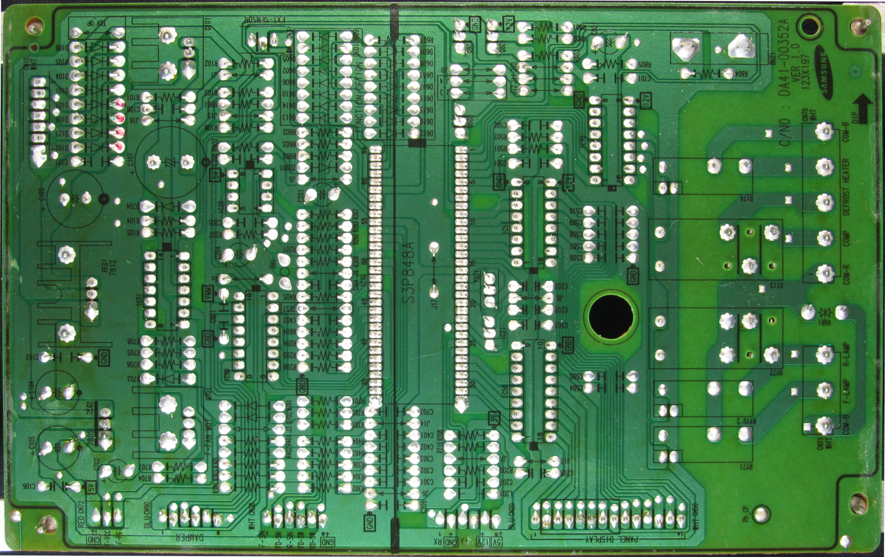
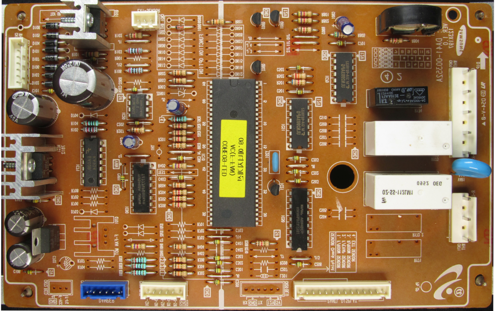
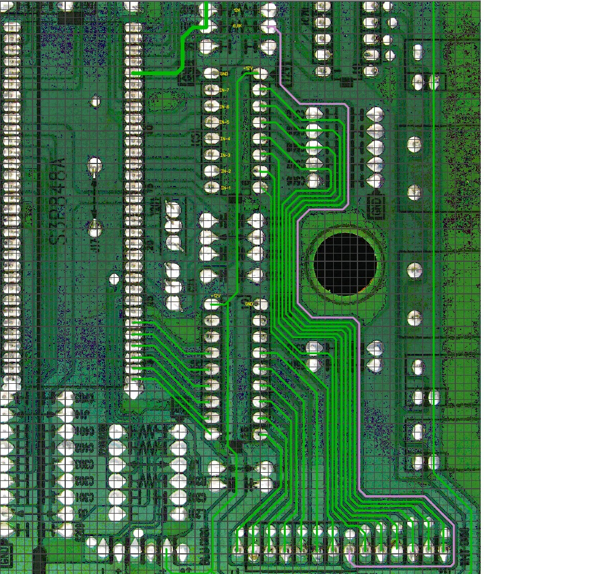

# Плата управления холодильника — неисправность кнопок панели индикации

Заметки по диагностике типовой платы управления холодильника с выносной передней панелью. Жалоба — панель управления не реагирует на нажатия кнопок. В ходе исследования неисправность была локализована в самих кнопках, несмотря на то что при обычной прозвонке они выглядели исправными.

> **Результат:** обнаружены две кнопки с паразитной проводимостью (утечкой) в ненажатом состоянии. Кнопки заменены. Модель холодильника и результаты последующей эксплуатации не зафиксированы.

## Фотографии

**Плата управления, сторона пайки**



**Плата управления, сторона компонентов**



**Дорожка линии считывания кнопок (`BTN_SENSE`)**



Фотографии самой передней панели не сохранились: диагностика выполнялась в спешке по просьбе владельца.

## 1. Первоначальная диагностика

Поступила плата управления очередного холодильника типовой конструкции. Со слов владельца, передняя панель не работала: не реагировала на кнопки и в целом вела себя некорректно.

Сначала была предоставлена только основная плата. Панель не передали, мотивируя это большим количеством проводов и сложностью подключения на рабочем столе.

При проверке основной платы установлено:

- питание присутствует и работает;
- плата запускается;
- реле срабатывают.

Очевидного отказа основной платы при такой проверке обнаружено не было. Без передней панели дальнейшая диагностика неисправности пользовательского интерфейса практически не имела смысла, поэтому её всё же запросили отдельно.

## 2. Устройство панели

После получения и подключения панели удалось установить принцип её работы.

На панели применены два многоканальных драйвера:

| Микросхема | Функция в исследованном узле |
|---|---|
| **ULN2003** | Управление линиями с коммутацией на землю (*low-side*, отрицательные линии) |
| **TD62783APG** | Управление положительными линиями питания (*high-side*) |

Индикация выполнена **дискретными светодиодами**, расположенными в виде семисегментных индикаторов. Светодиоды включены в матрицу и управляются через пересечения положительных и отрицательных шин.

Для сканирования клавиатуры используются те же положительные линии, которыми управляет TD62783APG:

- шесть кнопок подключены каждая к своей положительной шине;
- вторые контакты всех шести кнопок объединены;
- общий провод кнопок подключён к одному входу микроконтроллера, условно обозначенному здесь **`BTN_SENSE`**.

Соответствующая дорожка выделена на фотографии [`btn_sense.jpg`](btn_sense.jpg).

### Принцип опроса кнопок

Микроконтроллер последовательно активирует положительные линии через TD62783APG и одновременно контролирует состояние входа `BTN_SENSE`.

Если одна из кнопок нажата, импульс с соответствующей линии проходит через её замкнутые контакты на общий вход. По времени появления сигнала относительно активируемой шины микроконтроллер может определить, **какая именно кнопка нажата**.

Условная временная диаграмма:

```text
Время       ──────────────────────────────────────►

Шина 1      ┌───┐
            │   │
────────────┘   └──────────────────────────────────

Шина 2              ┌───┐
                    │   │
────────────────────┘   └──────────────────────────

Шина 3                      ┌───┐
                            │   │
────────────────────────────┘   └──────────────────

BTN_SENSE   ────────────────┌───┐──────────────────
(кнопка 3)                  │   │
                            └───┘
```

Диаграмма иллюстративная: реальные длительности импульсов, число последовательно активируемых шин и полярность сигнала на входе зависят от схемы входного каскада и прошивки.

В исправной системе **при всех отпущенных кнопках не должно быть импульсов, связанных с замыканием кнопок, на линии `BTN_SENSE`**. Уровень покоя определяется входной схемой; он необязательно равен нулю вольт.

## 3. Неисправность и поиск причины

После подключения панели обнаружена странность: **на входе считывания кнопок присутствовал сигнал даже тогда, когда ни одна кнопка не была нажата**.

Это указывало на нежелательную электрическую связь между одной или несколькими сканируемыми шинами и общим входом `BTN_SENSE`. Одной из вероятных причин стала утечка через контакты кнопок.

### Проверка методом исключения

1. Все кнопки были выпаяны из панели.
2. После их удаления паразитный сигнал на входе исчез.
3. Затем кнопки устанавливались обратно **по одной**.
4. Таким способом были выявлены **две кнопки**, с которыми нежелательный сигнал появлялся снова.
5. Обе неисправные кнопки были заменены.

При этом обычная проверка кнопок мультиметром в режиме прозвонки не выявляла явного дефекта: при нажатии и отпускании они вели себя ожидаемо.

Следовательно, неисправность не сводилась к постоянному низкоомному замыканию, которое легко обнаружить звуковой прозвонкой.

### Дополнительный эксперимент

Одна из подозрительных кнопок была разобрана. Из неё извлекли контактную мембрану, обеспечивающую замыкание при нажатии.

Однако **даже без мембраны паразитная проводимость каким-то образом сохранялась внутри корпуса кнопки**.

Это сильный аргумент в пользу внутренней утечки в конструкции кнопки — например, вследствие загрязнения, влаги или деградации изоляции. Конкретный физический механизм установлен не был, поэтому считать какую-либо из этих причин доказанной нельзя.

## 4. Почему прозвонка не обнаружила неисправность

Стандартный режим прозвонки обычно предназначен для обнаружения относительно низкого сопротивления, характерного для замкнутого контакта. Если между выводами имеется сопротивление утечки, существенно превышающее порог срабатывания звукового индикатора, мультиметр не подаст сигнал и кнопка будет выглядеть «разомкнутой».

Но вход микроконтроллера имеет высокое входное сопротивление, поэтому даже сравнительно слабая паразитная проводимость иногда способна изменить напряжение на входе или передать на него импульсы сканирования.

Для упрощённой модели с сопротивлением утечки `R_LEAK`, соединяющим активную шину с входом, и сопротивлением подтяжки к земле `R_PULL`, напряжение во время импульса приблизительно равно:

$$
V_{SENSE}\approx V_{SCAN}\frac{R_{PULL}}{R_{LEAK}+R_{PULL}}
$$

Например, **условно**, при `V_SCAN = 5 В`, `R_PULL = 100 кОм` и `R_LEAK = 100 кОм`:

$$
V_{SENSE}\approx5\cdot\frac{100}{100+100}=2{,}5\ \text{В}
$$

Такой сигнал может оказаться существенным для цифрового входа, хотя сопротивление 100 кОм при обычной прозвонке не воспринимается как замыкание.

**Это не измеренные параметры данной платы:** реальные сопротивления подтяжки, утечки и пороги входа микроконтроллера не определялись. Пример показывает, почему отсутствие звукового сигнала мультиметра не исключает дефекта в высокоомной цепи опроса кнопок.

## 5. Результат

| Проверка | Наблюдение |
|---|---|
| Питание основной платы | Исправно |
| Запуск платы | Есть |
| Работа реле | Срабатывают |
| Линия `BTN_SENSE` при отпущенных кнопках | Наблюдались нежелательные импульсы |
| Все кнопки выпаяны | Паразитный сигнал исчез |
| Поочерёдное возвращение кнопок | Обнаружены две проблемные кнопки |
| Прозвонка подозрительных кнопок | Явной неисправности не показала |
| Разборка одной кнопки, удаление мембраны | Утечка сохранялась |
| Выполненное действие | Замена двух кнопок |

После локализации неисправности две проблемные кнопки были заменены. Отдельные результаты длительной проверки и дальнейшей эксплуатации холодильника не документировались.

## 6. Выводы

1. **Проверять пользовательский интерфейс без самой панели недостаточно.** То, что основная плата включается и щёлкает реле, ещё не доказывает исправность цепей управления и индикации.
2. **Матричный опрос позволяет локализовать неисправность по временной связи импульсов.** Если вход кнопок реагирует при отсутствии нажатий, следует искать паразитные связи с активируемыми шинами.
3. **Прозвонка не равна проверке изоляции.** Кнопка может корректно замыкаться при нажатии, но иметь значимую утечку в отпущенном состоянии.
4. **Эксперимент с выпаиванием и поочерёдной установкой компонентов оказался решающим.** Он позволил отделить неисправность кнопок от возможных дефектов проводников или входного каскада.
5. **Даже удаление контактной мембраны не устранило утечку**, что указывает на проблему внутри корпуса кнопки, но не устанавливает её конкретную природу.

---

## Материалы

```text
README.md
IMG_1430_cr_A.jpg       # плата, сторона пайки
IMG_1430_cr_A2.jpg      # плата, сторона компонентов
btn_sense.jpg           # выделенная линия считывания кнопок
```

> Название модели холодильника, обозначение микроконтроллера, точные параметры сканирования и электрические характеристики утечки не зафиксированы. Приведённые иллюстративные схемы и расчёты не следует принимать за измеренные значения.
