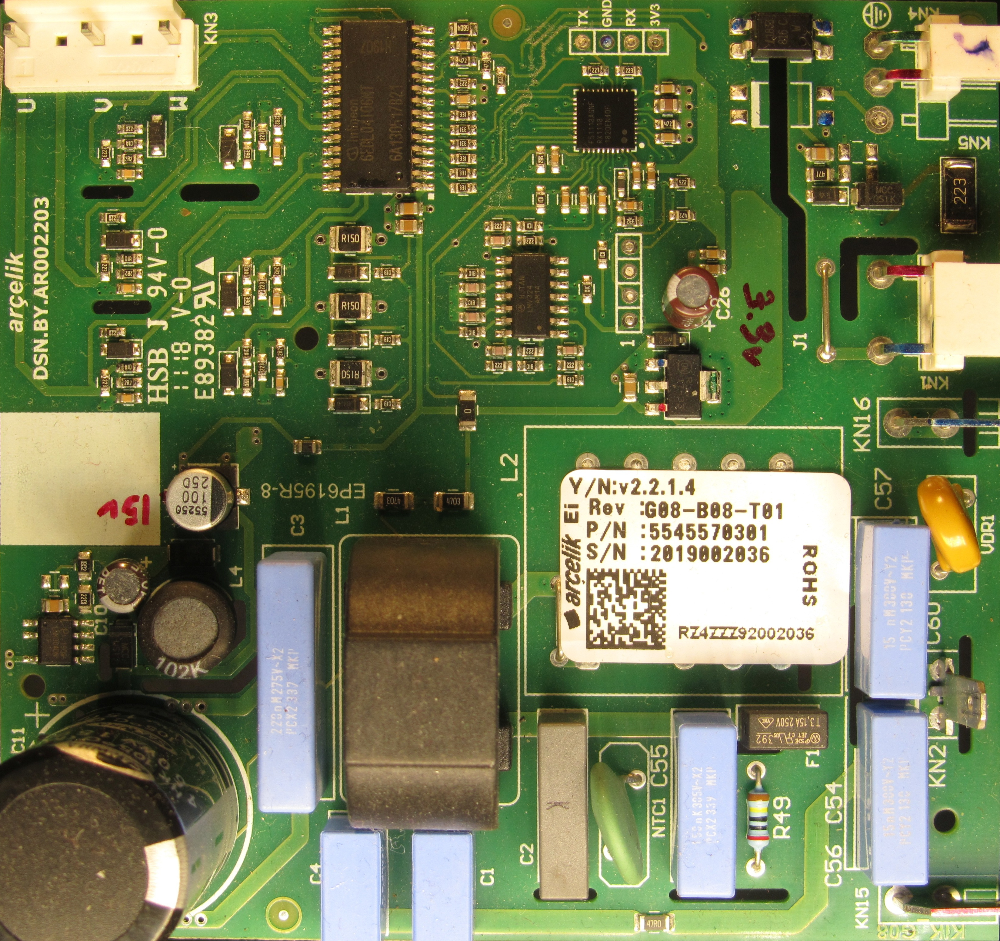
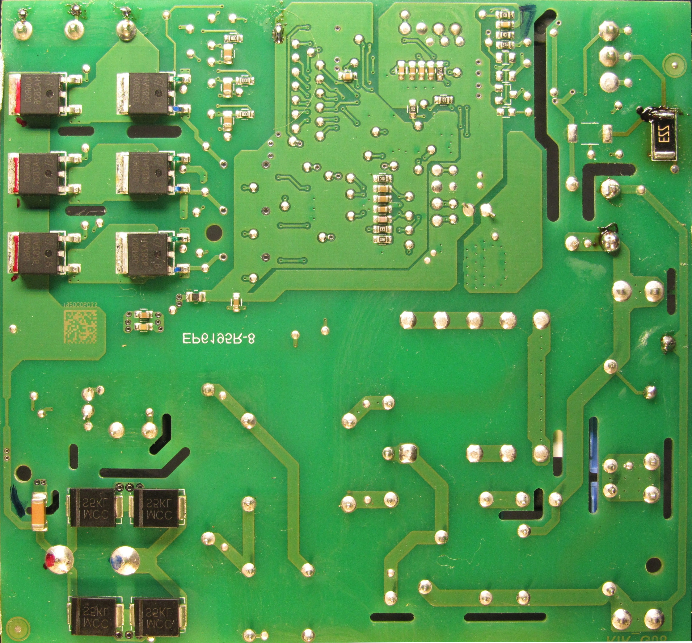
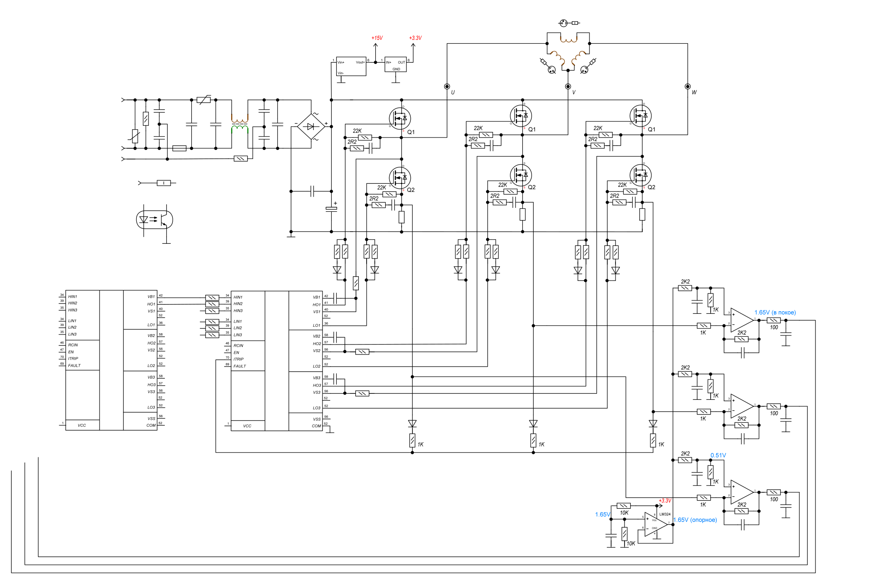

# Инвертор компрессора холодильника — исследование платы и диагностика нестабильного запуска

Заметки по диагностике платы трёхфазного инвертора компрессора холодильника. Точная модель холодильника и маркировка платы здесь не указаны; основным материалом для анализа служит восстановленная по плате схема.

> **Результат:** компрессор практически всегда прерывал попытку запуска вскоре после её начала; примерно одна попытка из двадцати могла завершиться успешным запуском. Плату заменили, однако **конкретную неисправность исходной платы выявить не удалось**. Замена сама по себе не устанавливает причину отказа, поскольку результат дальнейшей эксплуатации в этих заметках не зафиксирован.

## Исходные материалы

**Сторона элементов**

**Сторона пайки**

### Восстановленная принципиальная схема

  

Схема сохранена отдельно в [`sch.svg`](sch.svg) и может быть открыта в полном разрешении. Она отражает результаты восстановления соединений; отдельные обозначения и номиналы необходимо сверять с оригинальной платой.

---

## 1. Симптомы

При подаче команды на запуск компрессор начинал запускаться, но почти сразу процесс прерывался. Отказ был **не постоянным**: по наблюдениям, приблизительно одна попытка из двадцати могла быть успешной.

Такая картина сама по себе не позволяет установить, что неисправна именно силовая часть инвертора. Преждевременное завершение пуска может быть следствием реакции защиты на обнаруженное условие, нарушения формирования управляющих сигналов, особенностей питания или проблемы в самом компрессоре. Без измерений и подтверждающего эксперимента эти объяснения остаются гипотезами.

В ходе работ была восстановлена схема платы, но надёжно локализовать причину нестабильного пуска не удалось. В конечном итоге плату заменили.

## 2. Что видно по восстановленной схеме

На схеме можно выделить несколько функциональных узлов:

- **Сетевой вход и выпрямление:** входные фильтрующие элементы, диодный мост и конденсаторы звена постоянного тока.
- **Вспомогательное питание:** преобразование напряжений для управляющей электроники; на схеме обозначены шины `+15V` и `+3.3V`.
- **Трёхфазный силовой мост:** шесть MOSFET, по два ключа на каждую фазу `U`, `V` и `W` компрессора.
- **Драйверы затворов:** формируют сигналы управления верхними и нижними ключами моста.
- **Шунты и измерительные усилители:** три канала, связанные с нижними плечами силового моста и предназначенные для преобразования малых напряжений в сигналы, удобные для дальнейшей обработки контроллером.
- **Источник опорного напряжения:** на схеме показано формирование уровня около `1.65 V` от питания `3.3 V` с помощью делителя и буфера на ОУ.

Восстановленная схема полезна для трассировки питания, силовых цепей и измерения токовых сигналов, но не раскрывает внутреннюю логику прошивки контроллера и критерии прекращения запуска.

## 3. Обработка напряжения на токовых шунтах

Один из наиболее интересных узлов - усилитель напряжения с шунта на операционном усилителе (на схеме показана цепь с резисторами **1 кОм** на входе и **2,2 кОм** в обратной связи).

### 3.1. Смещение относительно нуля

Для обработки сигнала, который может менять знак относительно выбранной точки отсчёта, в однополярной системе питания удобно использовать смещённый выход: при нулевом напряжении на шунте выход ОУ находится не около 0 В, а вблизи некоторого положительного уровня.

В рассматриваемом расчёте опорное напряжение неинвертирующего входа обозначено как

$$
V_+ \approx 0.516\ \text{В}.
$$

Значение **0,516 В** получается из расчётного делителя **1 кОм / 2,2 кОм** от опорного уровня около **1,65 В**:

$$
V_+ \approx 1.65\frac{1}{2.2+1} \approx 0.516\ \text{В}.
$$

Здесь важно различать два уровня: **1,65 В** - исходный опорный уровень, **0,516 В** - расчётное напряжение на неинвертирующем входе данного каскада. Фактические значения требуют проверки на плате.

### 3.2. Узловое уравнение

На инвертирующий вход подаётся:

- напряжение шунта $V_{shunt}$ через **1 кОм**;
- обратная связь с выхода $V_{out}$ через **2,2 кОм**.

Для идеального ОУ в режиме отрицательной обратной связи:

$$
V_-\approx V_+\approx0.516\ \text{В}.
$$

По первому закону Кирхгофа для узла инвертирующего входа:

$$
\frac{V_{shunt}-V_-}{1\,\text{кОм}}+
\frac{V_{out}-V_-}{2.2\,\text{кОм}}=0.
$$

Выражая выходное напряжение:

$$
V_{out}=V_-+2.2(V_--V_{shunt}),
$$

откуда при $V_-\approx0.516$ В:

$$
\boxed{V_{out}\approx1.65-2.2V_{shunt}}.
$$

То есть это **инвертирующий каскад с коэффициентом передачи по напряжению шунта −2,2 и смещением выхода около +1,65 В**.

### 3.3. Примеры расчёта

| Напряжение шунта | Расчётный выход ОУ |
|---:|---:|
| −0,10 В | $1.65-2.2(-0.10)=1.87$ В |
| 0 В | $1.65$ В |
| +0,10 В | $1.65-2.2(0.10)=1.43$ В |

**Примечание:** значения иллюстрируют математическую модель узла. Они справедливы только пока ОУ работает в линейной области и реально удерживает виртуальное равенство входов. Диапазон выходного напряжения, входной синфазный диапазон, шумы, допуски компонентов и конкретная схема подключения шунта ограничивают точность этой модели.

### 3.4. Для чего нужен сдвиг уровня

При $V_{shunt}=0$ выход находится приблизительно посередине диапазона питания управляющей электроники ($1.65$ В при питании $3.3$ В). Изменения сигнала шунта в обе стороны приводят к изменениям выходного напряжения относительно этой средней точки.

Такой сигнал удобнее подавать на однополярный вход АЦП. По одному лишь изображению схемы нельзя достоверно определить, каким именно образом прошивка использует показания: для управления током, диагностики пуска, аварийного отключения или сочетания этих задач.

## 4. Возможные направления диагностики нестабильного пуска

Ниже не перечень обнаруженных дефектов, а **направления проверки**, вытекающие из структуры схемы и симптомов:

1. **Звено постоянного тока:** наличие требуемого напряжения, провалы и пульсации непосредственно во время пуска.
2. **Вспомогательные шины:** устойчивость `+15 V` и `+3.3 V` в момент попытки запуска.
3. **Управление силовыми ключами:** наличие ожидаемых импульсов, корректность работы верхних/нижних драйверов и отсутствие аномалий в управляющих сигналах.
4. **Токовые каналы:** уровень около 1,65 В в покое, симметрия каналов и их поведение при попытке запуска.
5. **Компрессор и соединения:** состояние обмоток, разъёмов и кабеля; при возможности — проверка в заведомо исправной конфигурации.
6. **Логика отключения:** удаётся ли зафиксировать диагностические признаки или сигнал неисправности перед прекращением пуска.

Работа с сетевым инвертором и силовым DC-звеном опасна. Измерение сигналов верхних плеч и узлов, имеющих потенциал сети, требует соответствующих пробников, развязки измерительной системы и соблюдения требований электробезопасности. Землю обычного осциллографического пробника нельзя произвольно подключать к силовым узлам.

## 5. Итог

| Наблюдение / работа | Результат |
|---|---|
| Запуск компрессора | Большинство запусков прерывались почти сразу |
| Редкие успешные старты | Примерно один из двадцати |
| Восстановление схемы платы | Выполнено, `sch.svg` |
| Исследование цепи усиления сигнала шунта | Получено расчётное выражение $V_{out}\approx1.65-2.2V_{shunt}$ |
| Конкретный неисправный элемент или узел | **Не определён** |
| Принятое решение | **Замена платы** |
| Подтверждённая причина нестабильного запуска | **Не установлена** |

Этот случай сохранён в репозитории прежде всего ради **восстановленной схемы** и анализа измерительных каскадов.
Он также напоминает, что замена узла и доказанная локализация неисправности - разные результаты диагностики.

